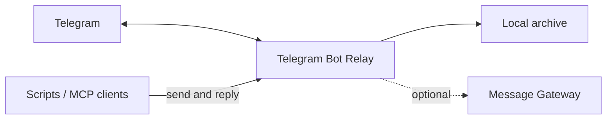
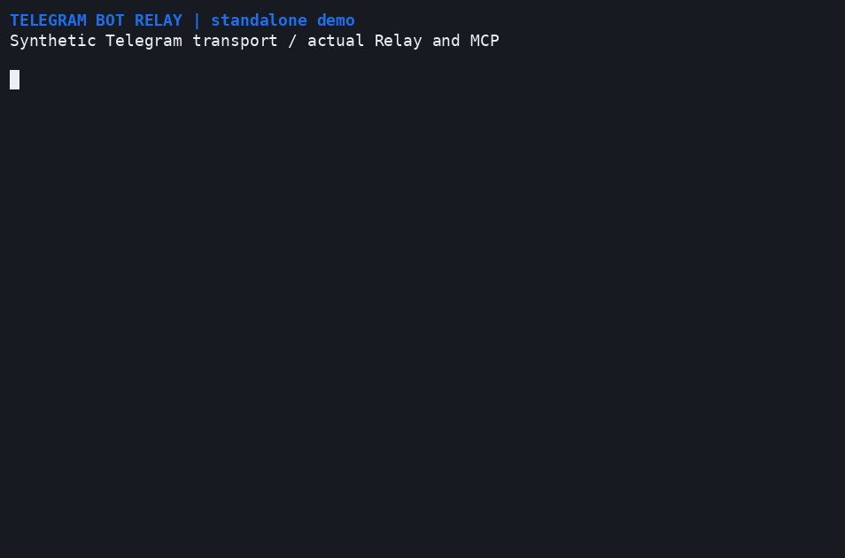

# Telegram Bot Relay

Connect a Telegram bot to your scripts and MCP clients. Relay saves incoming
updates and attachments in a local archive and provides HTTP and MCP operations
for sending messages, replies, files and reactions.

Use it to keep a record of bot activity, send notifications from existing tools,
or give an interactive session a Telegram connection. One process owns one bot;
multiple clients share its operations and access policy.





*Actual Relay and MCP, with explicitly synthetic Telegram transport.*
[Static view and reproduction](docs/demo.md).

## Start here

Install [uv](https://docs.astral.sh/uv/) and use Python 3.12 or later. From this
source checkout, prepare a private configuration using
[the example](examples/config.toml) and the [run guide](docs/operations.md#configure).
Set your bot/API token files and allowed numeric user/chat IDs before starting:

```sh
uv sync --locked
uv run --locked telegram-bot-relay --config /absolute/private-config.toml
```

Relay works independently: scripts can consume its archive and send through
HTTP or MCP. For incoming delivery to an existing Codex conversation, pair it
with [Message Gateway](https://github.com/dmitry-ra/message-gateway) using the
[complete Telegram + Gateway cookbook](docs/codex.md). Replies go through Relay.

## Guides

| I want to... | Read |
| --- | --- |
| Configure, run or troubleshoot a bot | [Operations](docs/operations.md) |
| Send messages from a program or MCP client | [HTTP and MCP](docs/api.md) |
| Understand archives and delivery guarantees | [Architecture](docs/architecture.md) |
| Change the project or run checks | [Testing](docs/testing.md) |
| Operate the repository with an agent | [Usage skill](.agents/skills/operate-telegram-relay/SKILL.md) |

[MIT license](LICENSE).
