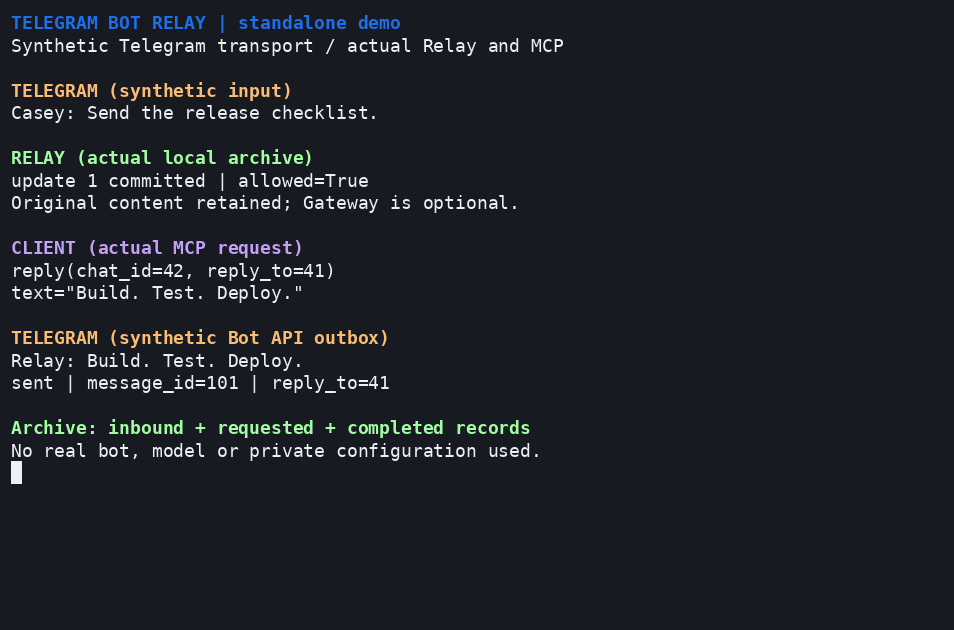

# Standalone usage demonstration



The [animation](assets/relay-demo.gif) shows a synthetic Telegram message entering
the actual Relay access, journal and attachment-preparation code. A real local
MCP client calls `reply`; Relay's operations and Telegram SDK send that request
to a local Bot API simulator. The last panel displays that simulator's received
request and the actual Relay outcome. Gateway is not required for this example.

This is a credential-free local pipeline demonstration, not evidence of live
Telegram delivery, bot polling, startup locking or model behavior. The incoming
fixture is passed directly to `Service.ingest`; no production bot is contacted.
Both HTTP servers bind only to loopback, all files live in a temporary directory,
and the process closes its servers and removes its temporary archive on exit.

## Run the example

From the source checkout:

```sh
uv sync --locked --group dev
uv run --locked python tools/demo.py
```

Use `--pace 0` for a fast smoke check; the regular local check runs this mode.
The public [fixture](../tools/demo/fixture.json) contains an invented user and
message. [The demo program](../tools/demo.py) checks actual archive decisions,
the MCP outcome, the received reply parameters and requested/completed records.
It does not print hand-authored success results or invoke a model to answer.

## Rebuild the images

Recording tools used: asciinema 3.2.1, agg 1.9.0, FFmpeg 6.1.1 and the
DejaVu Sans Mono font. The renderer checks the asciinema/agg versions. Install
those tools separately; they are not runtime dependencies of Relay.

```sh
uv run --locked python tools/render_demo.py
```

The renderer records an 86x27 terminal, removes capture metadata other than the
dimensions, neutral title and TERM, and trims only the leading startup idle time.
The [sanitized recording](assets/relay-demo.cast) retains actual output and event
timing. agg renders a 954px-wide GIF; FFmpeg creates its static final frame.
To create an additional contact sheet outside the repository, pass
`--review-dir /absolute/review-directory`.

Before publishing a recording, inspect the entire animation and contact sheet.
Check text, captions, terminal metadata and paths for private content; a marker
scan is a supporting check, not a replacement for visual review. Only the two
named documentation images are exempted from source ASCII decoding. The source
distribution contains the reproduction tools, fixture, recording and images;
the runtime wheel contains none of the demo assets or developer tools.

For real use, follow [operations](operations.md); for Telegram input into an
existing conversation, use the [joint cookbook](codex.md).
